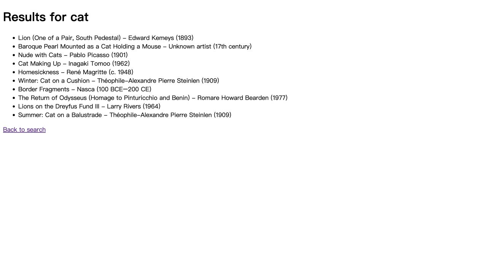

This app is for people who want to search for artworks from the Art Institute of Chicago.

To run it, open a terminal in the hcde310 folder:

```bash
python3 -m venv .venv
source .venv/bin/activate
python -m pip install flask requests
cd hw4
python -m flask --app app run --debug
```

Open http://127.0.0.1:5000 in your browser. An internet connection is needed to search.


