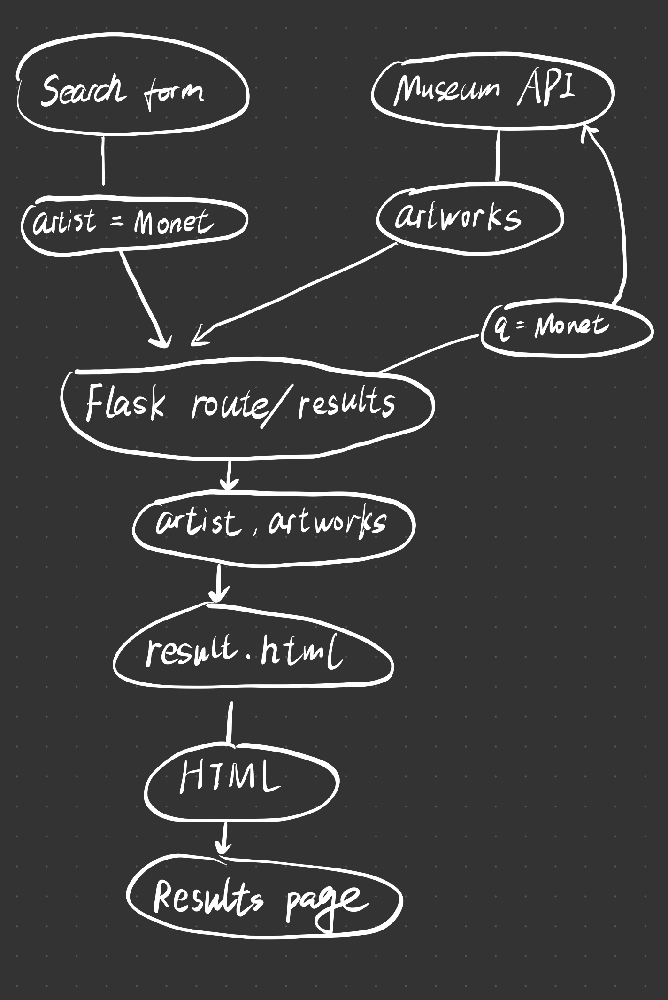

# HW5 findings

## 1. Drawing: one search for "Monet"

## 2. Two questions about the code
1. what do or "" and .strip() do?
2. What happens if the API returns an HTTP error

## 3. Checks (4 or more, at least 2 as pytest tests)
| # | Check | Pass or fail |
|---|---|---|
| 1 | Home page shows the search form| Pass |
| 2 | Spaces-only input shows an empty-search message| Pass |
| 3 | Searching 'Monet' shows 1–10 artworks| Pass |
| 4 | Searching 'rogerrrr' shows a no-results message| Fail |

## 4. AI review
What it found that I missed: If the API request fails, the app shows the raw error message and still returns HTTP 200. My checks did not cover API failures.
What it got wrong: I didn’t find a clear factual mistake. The AI flagged the form label and no-results message as things to verify. I checked the templates and found that both are already there.
Answers to my two questions, in my own words: 
1. `or ""` defaults to an empty string. `.strip()` trims whitespace.
2. `raise_for_status()` raises an exception, and Flask catches it and shows an error message.

## 5. My fix
What was wrong: When the API failed, the page showed the raw error and returned HTTP 200.
What I changed: The app logs the error and shows a short message with HTTP 502.
How I checked it works: I simulated an HTTP error. The page showed the new message, hid the raw error, and returned 502. Both existing pytest tests passed.

Commit before: `30d5557`  
Commit after: `2e32cc8`

## 6. Can we ship it? (100–150 words)
Yes or no, and why:
I wouldn’t ship it tomorrow. The app returned ten artworks for Monet and showed a message for a blank search. After the fix, it also showed a clear message when the API failed. But searching for the made-up name rogerrrr still returned ten artworks. A user could maybe think those works were made by the artist they searched for.I would improve how the search matches artist names. Then I would test both names again. I’d check that the Monet results are works by Monet and that a madeup name shows a clear no results message on the page.
One thing my HW4 does better: Users can share the search results URL because the form uses GET
One thing the AI's app does better: It shows pictures of the artworks

AI use goes in `ai_use.md` (the five points on the AI Use Card).
